<picture>
  <source media="(prefers-color-scheme: dark)" srcset="assets/header-dark.svg">
  
</picture>

**[Now](#now)** · **[Working with me](#working-with-me)** · **[Earlier](#earlier)** · **[Elsewhere](#elsewhere)**

Senior AI/ML Engineer at [Express Analytics](https://expressanalytics.com), in the UAE. This is my work account, so the repositories below open only for the team. My public projects are on [@ajmalaksar25](https://github.com/ajmalaksar25).

## Now

Most of my time goes into [kAInet](https://expressanalytics.com/agentic-ai), our agentic AI platform for marketers. Tag me on any of these:

- **[Agent backend](https://github.com/ExpressAnalytics/agentic-marketing)** · plans Google and Meta campaigns with a marketer, then launches them once the marketer approves
- **[Web app](https://github.com/ExpressAnalytics/marketingai)** · the chat, the campaign editor and the dashboards marketers work in
- **[Harness](https://github.com/ajmal-ea/kAInet-harness)** · research, plan, act behind approval, verify, with evals that check the agents before anything touches a real ad account
- **[datask](https://github.com/ExpressAnalytics/datask)** · ask your data warehouse a question in plain English; it proposes the KPIs and runs the SQL

Merged so far: 850 PRs on the backend since August 2025, 161 on the web app, and 166 on the harness since it started on 3 November.

## Working with me

- **Asking for a review?** Add a short note on how you tested the change. I check it against a real run, not only the unit tests, so the note saves us both a round.
- **Something for later?** Open an issue and assign it to me instead of leaving it in chat. Issues are where I track follow-ups; chat messages get buried fast.

## Earlier

At Express Analytics I also built an OCR document-processing system, a RAG chatbot, and the data pipelines behind our customer analytics work.

## Elsewhere

[Personal GitHub](https://github.com/ajmalaksar25) · [Blog](https://ajmalaksar.vercel.app/blog) · [LinkedIn](https://www.linkedin.com/in/ajmalaksar/)

I write about building and debugging agent systems on the blog.
